<div align="center">


# DMoney API Load Testing with k6

Automated multi-phase performance and load tests for the **DMoney** fintech platform, built with Grafana k6 and k6-reporter.


</div>

---

## 📑 Table of Contents

- [Project Overview](#-project-overview)
- [Test Scenarios & Phases](#-test-scenarios--phases)
- [Prerequisites](#-prerequisites)
- [File Structure](#-file-structure)
- [Setup & Execution](#️-setup--execution)
- [Performance Metrics & Results](#-performance-metrics--results)
- [Screenshots](#-screenshots)
- [Tech Stack](#-tech-stack)
- [Author](#-author)

---

## 📌 Project Overview

This project simulates realistic traffic across multi-phase transaction scenarios on the DMoney fintech platform ([https://dmoney.roadtocareer.net](https://dmoney.roadtocareer.net)). It validates **response times**, **system stability**, and **request success rates** under concurrency, without breaching the defined thresholds.

**Roles covered:** Agents · Customers · Merchants
**Transactions covered:** Send Money · Payment · Deposit

---

## 🎯 Test Scenarios & Phases

**Total duration: 2 minutes**

| Phase | Time Window | Virtual Users | Transactions |
|:-----:|:-----------:|:-------------:|--------------|
| 1 | 0s – 30s | 2 VUs | Send Money, Payment |
| 2 | 30s – 60s | 3 VUs | Send Money, Payment, Deposit |
| 3 | 60s – 90s | 4 VUs | Deposit, Payment |
| 4 | 90s – 120s | 4 VUs | Payment (continuous) |

```mermaid
gantt
    title DMoney Load Test Timeline (120s)
    dateFormat  X
    axisFormat  %Ss
    section Phase 1 · 2 VUs
    Send Money + Payment            :0, 30
    section Phase 2 · 3 VUs
    Send Money + Payment + Deposit  :30, 60
    section Phase 3 · 4 VUs
    Deposit + Payment               :60, 90
    section Phase 4 · 4 VUs
    Payment (continuous)            :90, 120
```



---

## 🛠 Prerequisites

Make sure the following tools are installed:

- [k6](https://k6.io/docs/get-started/installation/) **v0.40+**
- [Node.js](https://nodejs.org/) **v18+**

---

## 📂 File Structure

```plaintext
dmoney-k6-test/
├── screenshots/            # Test report screenshots
├── script.js               # Main k6 multi-phase load testing script
├── setup_auth.js           # Token generation via admin OTP verification
├── setup_all.js            # Runs the complete setup flow
├── seed_users.js           # Creates Agents, Customers and Merchants
├── generate_tokens.js      # Generates JWT tokens for all roles
├── fetch_tokens.js         # Fetches and saves tokens to tokens.json
├── activate_and_deposit.js # Activates accounts and adds initial deposit
├── deposit_balance.js      # Deposits balance into accounts
├── recharge_agents.js      # Recharges agent balances
├── recharge_customer.js    # Recharges customer balances
├── balance_fix.js          # Fixes account balances before a run
├── check_balances.js       # Checks current account balances
├── check_status.js         # Checks account/system status
├── users.json              # Credentials and account details
├── tokens.json             # Active JWT Bearer tokens for all roles
└── report.html             # Generated k6-reporter HTML dashboard
```

---

## ⚙️ Setup & Execution

### 1. Authenticate & Prepare Accounts

Generate fresh bearer tokens and initialize account balances:

```bash
k6 run setup_auth.js
```

> **Note:** Make sure the tokens printed in the console output are saved into `tokens.json`.

### 2. Run the Load Test

Execute the full multi-phase scenario suite:

```bash
k6 run script.js
```

### 3. View the Test Report

Open the generated report in your default browser:

```powershell
Start-Process report.html
```

---

## 📊 Performance Metrics & Results

> Report generated: **2026-10-11 03:44** (k6-reporter v3.0.4)

### Overall Summary

| Metric | Result |
|--------|:------:|
| Total Requests | **230** (1.90 req/s) |
| Total Iterations | **86** (0.71 iter/s) |
| Virtual Users | Min **2** · Max **8** |
| Breached Thresholds | **0** ✅ (Passed) |
| Failed Requests | **4** (1.74%) |
| Checks | **226** passed · **4** failed |
| Data Received / Sent | 0.16 MB / 0.05 MB |

### Response Times (ms)

| Metric | Avg | Min | Med | Max | P(90) | P(95) |
|--------|:---:|:---:|:---:|:---:|:-----:|:-----:|
| `http_req_duration` | 177.36 | 129.62 | 160.08 | 328.44 | 241.20 | 275.96 |
| `deposit_response_time` | 229.55 | 169.36 | 219.68 | 327.83 | 312.05 | 319.01 |

### Success Rates

| Transaction | Success Rate | Passed | Failed | |
|-------------|:------------:|:------:|:------:|---|
| Send Money | **100.00%** | 54 | 0 |  |
| Payment | **100.00%** | 118 | 0 |  |
| Deposit | **93.10%** | 54 | 4 |  |

### Key Observations

- All defined thresholds passed (**0 breached**) with only 4 failed requests (1.74%).
- **Send Money** and **Payment** were fully stable with zero failures.
- All 4 failures came from **Deposit** (93.10% success), which is the only area needing attention.
- Median latency of ~160ms and P(95) of ~276ms show consistently fast responses, with a max of ~328ms and no major spikes.

---

## 📸 Screenshots

All test run screenshots are also available here:

### 🔗 [View All Screenshots on Google Drive](https://drive.google.com/YOUR_DRIVE_LINK_HERE)

### Report Summary & Response Times


### Success Rates


### Test Run Details


### Checks


---

## 🧰 Tech Stack

<p>
  
  
  
  
  
</p>

---

## 👤 Author

**Md. Ebnul Ahsan**
CSE Student, AIUB · Full-Stack · DevOps · QA

[](https://github.com/EbnulAhsan)

---

<div align="center">

⭐ If you found this project useful, consider giving it a star!

</div>
